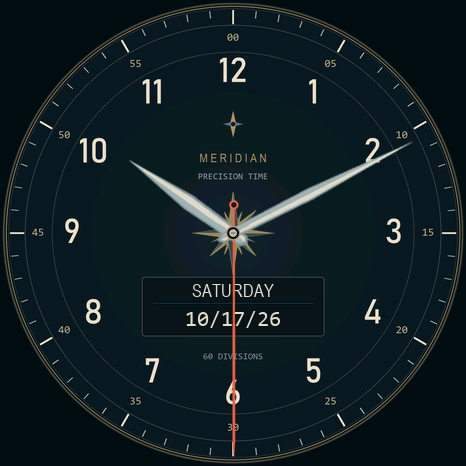

# Orb of Many Faces

A lightweight clock-only firmware for the Waveshare **ESP32-S3-Touch-AMOLED-1.75**
Orb: swipe through clocks, turn the knob for volume, and hear a bell on the hour.

**[Download the installer ZIP from Releases](https://github.com/GarlicSoftware/orbOfManyFaces/releases/latest).**
Use the ZIP attached under **Assets**. GitHub's **Code > Download ZIP** downloads
source code and does not include the compiled installer images.



## Controls

| Action | Result |
|---|---|
| Swipe horizontally | Next/previous face in the selected group |
| Turn the knob | Tick and hourly-bell volume; zero mutes both |
| Hold the knob about 1.5 seconds | Open the group menu |
| Turn in the menu, then press | Choose a group |
| Hold again, or wait 30 seconds | Close the menu |

Version **0.5.1** includes eight built-in faces and 34 additional CC0 clock faces
in four SD groups: **42 distinct designs**. Blue Meridian is first in every SD
group and remains available without a card. The other Meridian face is Brass &
Parchment. Group, face and volume are remembered after restart.

Groups preload compressed artwork and fonts into RAM when selected. Normal
ticks and face switches do not read SD. Selecting a group takes a few seconds.
Complex oversized rotating layers use cheaper sampling to keep up with the clock.
Animated source backgrounds use their still image.

The hourly bell is one short bell at the start of each local hour, rather than
a count of the hour. It replaces that second's tick. It does not ring on startup
or replay hours after time synchronization. A short grace window covers group
loading across the hour. Volume zero mutes the bell and ticks together.

## Favorites (development branch)

Short-press the knob while a clock is displayed to add/remove that face as a
favorite. It does not navigate. A filled star confirms adding, an outlined star
confirms removal, and a red cross means saving failed (for example, no writable
SD card). On swiping to a favorite, its star appears briefly, then fades. Only
that small overlay is animated; normal clock rendering remains once per second.

Selections save immediately to independent, checksummed SD records and survive
restart. They do not rebuild artwork automatically. With pending changes, opening
the group menu offers **Build Now** or **Later**. Later retains the existing
Favorites and adds **Update Favorites** to the normal menu. That choice is
remembered; only additional changes cause another prompt.

An approved rebuild copies the original compressed artwork/fonts on the Orb,
splits by actual packed size, decoded-image RAM and font metadata (with allocator
headroom), shows progress,
and validates every replacement before committing the new catalog. Existing
libraries and the previous Favorites remain intact if building fails. Missing
source artwork causes an error rather than silently dropping a bookmark. Keep
original libraries installed for later rebuilds. Favorites require a writable
FAT32 SD card and load into RAM like ordinary groups; ticks and cached swipes
perform no SD reads.

**Favorites contain only explicitly selected faces. Blue Meridian is not added
automatically.** Labels progress through Favorites, More Favorites, More More
Favorites, Too Many Favorites, More Too Many Favorites, We Need to Talk, then
increasingly questionable names. Rebuilds consolidate where possible and update
the display labels. Internal group IDs do not depend on those names. Long selected
labels scroll in the menu instead of being truncated.

Favorites data lives separately in `/clock-favorites/`; do not manually edit its
binary selection/catalog records. Two verified state banks and committed group
generations protect against interrupted writes. The compact bookmark index retains
source references for removed faces so they can be re-added from an old Favorites
library; it currently holds up to 512 distinct face identities. No original `.ocg`
library is modified. Future importer work is tracked in [ROADMAP.md](ROADMAP.md).
Development checks are recorded in [favorites validation](docs/favorites-validation.md).

USB maintenance commands include `favorites status`, `favorites toggle`,
`favorites later`, `favorites build` and `menu choose N` (zero-based visible choice).
These run the same paths as the knob. Rebuild commands may take a minute or more
for a large collection; allow a longer serial timeout.

## Hardware and preparation

Use the Waveshare **ESP32-S3-Touch-AMOLED-1.75**, with 466x466 CO5300 display,
16 MB flash, 8 MB PSRAM, CST9217 touch and ES8311 audio. Similar round displays
and enclosures can contain different boards and require a firmware port.

First use the original [Orb OS](https://github.com/Ziplock78/orb-os) to connect
the recipient's own Wi-Fi and configure their timezone. This firmware reuses
those settings and the hardware RTC. It has no Wi-Fi setup screen. If no timezone
is stored, its fallback is US Eastern; a USB override is available, for example
`?clock timezone UTC0` at 115200 baud. Existing brightness/orientation are retained.

## Install the Release ZIP

1. Install **Python 3.12** (recommended). The installer is tested on Python 3.10-3.12;
   newer Python versions are not qualified. If dependencies fail on a newer version,
   use Python 3.12. On Windows, enable Python's PATH option or use `py -3.12` instead
   of `python` in the commands below.
2. Extract the Release ZIP and open a terminal inside its extracted folder.
3. Install the two installer dependencies:

   ```text
   python -m pip install -r requirements-install.txt
   ```

   This installs `esptool==4.8.1` and `pyserial==3.5`. No graphics libraries are needed.
4. Connect USB with a compatible FAT32 SD card already installed, close other
   serial programs, then run **one installation command**:

   ```text
   python install.py --port COM7
   ```

The installer verifies all packaged images and packs, backs up your Orb, flashes
firmware, waits for reboot, then uploads all four SD libraries through USB.
**Eight faces live in firmware and 34 additional faces live on SD: 42 total.**
The completion summary names installed or verified existing packs and reports the
number of faces verified available from this release. Other user libraries are
not included in that count.

**Already running Orb of Many Faces, including v0.5.0? Run the same command.**
It preserves settings and existing SD files, skips packs whose stored size and
SHA-256 match, and refuses to overwrite conflicting files. You do not need to
open the Orb or remove its card. Interrupted uploads use temporary `.part` files;
retrying restarts only incomplete packs. Transfers are read back and checked
before becoming visible in the menu. Your current face/library is retained.

Hold the knob about **1.5 seconds**, turn to a library, then press once to load it.
Swipe horizontally to change faces within it. Turn the knob outside the menu
for volume. Blue Meridian is included in every library.

Without a working card, firmware installation still succeeds with eight built-in
faces. A full card, conflicting filename, unplugged USB or other optional upload
failure produces an explanation and a retry command. After a successful flash,
optional SD errors do not change the installer's success exit status; inspect the
face-count summary for SD completion. `--sd-only` and the manual uploader return
a failure exit status if any pack could not be verified.

Replace `COM7` with the actual device port. Linux commonly uses `/dev/ttyACM0`;
macOS commonly uses `/dev/cu.usbmodem...`. If necessary, hold BOOT, tap RESET,
release BOOT, and try again.

The installer saves a complete **recipient-device 16 MB backup** before writing.
This can take several minutes; keep the USB cable connected until it finishes.
It checks the backup size, then writes the supplied bootloader, partition table
and app at their explicit addresses. It does not whole-chip erase or overwrite
NVS/settings or themeart. SD uploads write only the bundled filenames under
`/clock-groups/`; they never format the card or replace existing final files. The backup contains the recipient's own
settings; keep it private. `python install.py --port COM7 --dry-run` shows the
commands without accessing hardware.

To restore, substitute the actual backup path and port:

```text
python -m esptool --chip esp32s3 --port COM7 write_flash 0x0 orb-backups/DATE-TIME/orb-before-install.bin
```

## Retry or manually install SD groups

Normal installation already uploads all four packs. If the card was missing or a
transfer failed, retry **without flashing again or changing settings**:

```text
python install.py --port COM7 --sd-only
```

The separate uploader remains available for troubleshooting (requires v0.5.1
firmware for verified uploads):

```text
python tools/upload_groups.py --port COM7
```

For a filename conflict, the existing file is left untouched. Keep a copy and
rename it yourself before retrying if appropriate; the installer never decides
that a different user file is safe to replace. Check USB connection/port and free
space if a transfer fails. Use `--skip-sd` for a firmware-only install.
`python install.py --check` verifies the ZIP contents without hardware access.

As a final fallback, manually copy the four `.ocg` files listed in
`sd-groups/index.json` into **`/clock-groups/` at the root of a FAT32 SD card**.
Keep existing `/themes/` and unrelated files. No formatting is needed for a
compatible card. Restart the Orb to rescan manually copied groups. Missing,
corrupt or oversized groups fall back to the built-in clocks. A group cached
in RAM continues working if SD is removed.

## Source and new faces

This repository includes generated `src/assets.cpp`, so rebuilding needs neither
Windows fonts nor Orb Studio:

```text
python -m pip install platformio==6.2.0
python -m platformio run -e orb-clock
python tools/package_release.py
```

The resulting Release ZIP appears under `releases/`. Build dependencies and
versions are pinned in `platformio.ini`. Only the application at `0x10000` is
needed to update an already compatible clock installation; the packaged installer
also provides first-install images and a backup step.

`tools/build_sd_groups.py slug-one slug-two` builds RAM-bounded groups from
folders under `imported-faces/`. With no arguments it builds the included public
library. It converts only clock artwork/fonts/styles. Downloaded Orb Studio theme
files must first be extracted into that folder layout; ensure you have permission
before redistributing additional artwork. `tools/bake_assets.py` regenerates the
built-in art and needs Windows Arial Narrow/Consolas; ordinary firmware builds
use the generated assets already committed here.

USB diagnostics include `?clock status`, `groups`, `group N`, `face N`,
`volume 0..100`, `chime status`, `chime test` and `reboot`. The bell test respects
volume zero. Framebuffer capture is a maintenance feature; large legacy USB
captures can truncate on some hosts without affecting the display.

## Credits and licensing

Firmware and the two Meridian designs are MIT-licensed; preserve [LICENSE](LICENSE).
Board protocols and codec setup derive from Quique Tortosa and Zion Brock's
[Orb OS](https://github.com/Ziplock78/orb-os). See [NOTICE.md](NOTICE.md) for dependencies.

Community faces included here declare **CC0 1.0** in their original manifests.
[ARTWORK_CREDITS.json](ARTWORK_CREDITS.json) preserves their authors and source
slugs; original PNGs, styles and exported fonts are included. Artwork was cropped,
converted to RGB565/alpha, and compressed for this renderer. The public bundle
excludes themes marked all-rights-reserved, unspecified, or other Creative Commons
licenses; those may have different terms. The firmware's MIT license is not a
license grant for arbitrary themes downloaded elsewhere.
